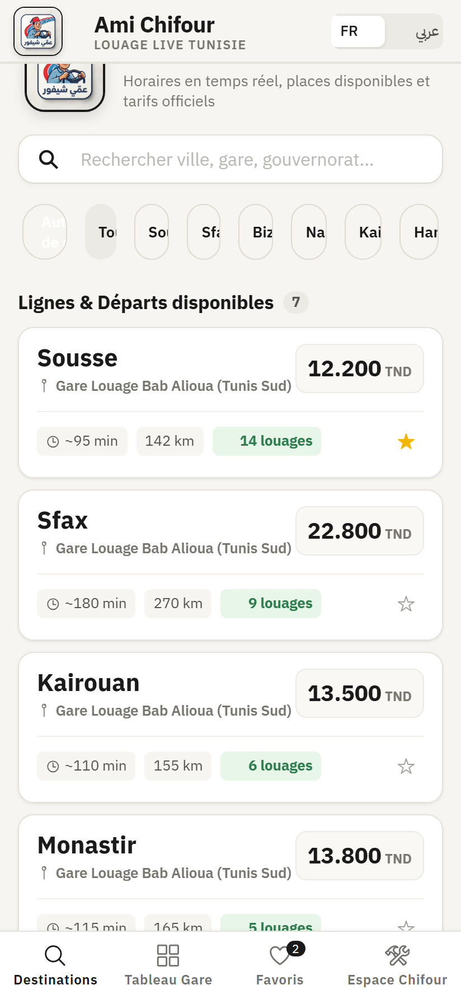
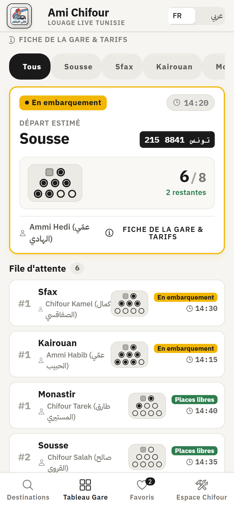
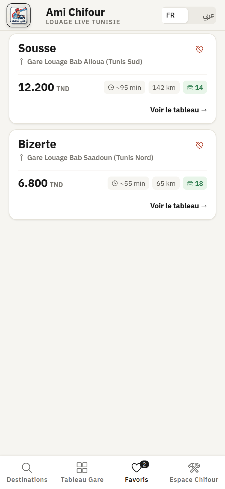
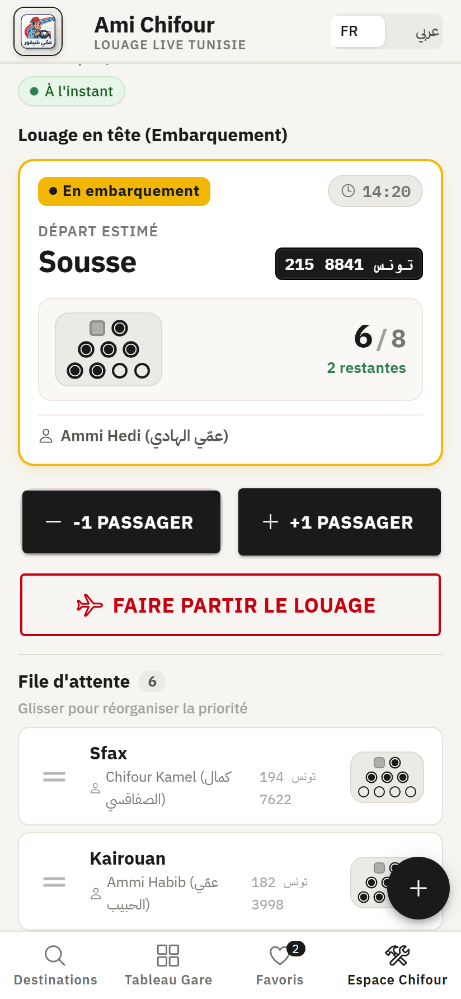
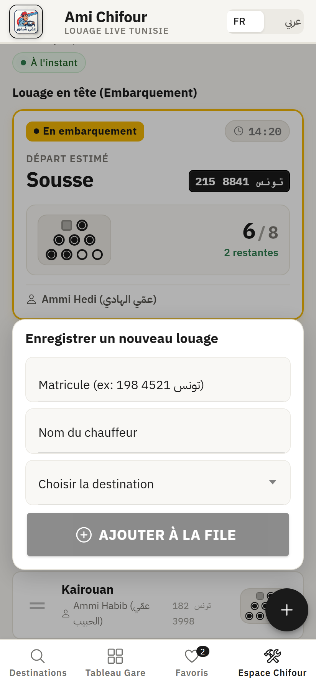
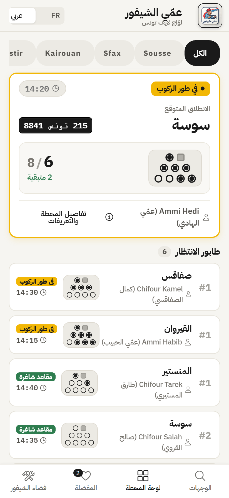
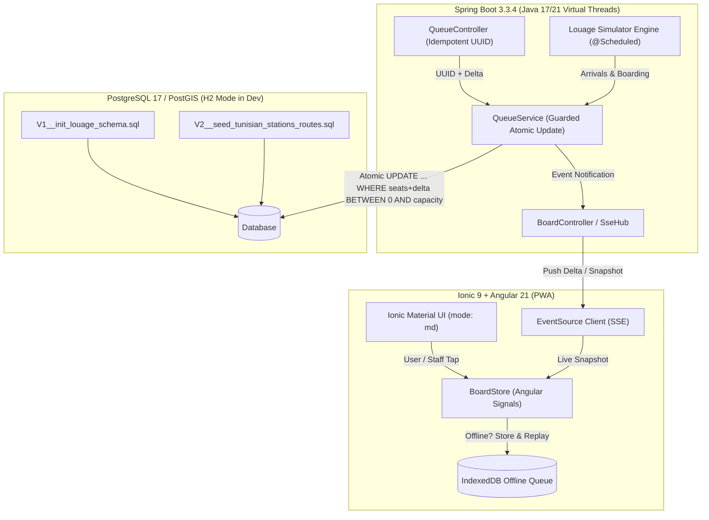

# عمّي الشيفور — Ami Chifour
### Live Departures & Quayside Queue Management for Tunisian Louages

<p align="center">
  
</p>

<p align="center">
  
  
  
  
  
  
  
</p>

---

## 🎯 Executive Overview

In Tunisia, intercity transport is powered by **Louages** — 8-seater shared minivans operating without fixed timetables: a louage departs strictly when all 8 seats are filled. 

**Ami Chifour (عمّي الشيفور)** is a real-time departures board and quayside regulator app.
- **For Riders:** Know which vehicle is currently boarding, how many seats remain, official government-regulated tariffs, and realistic departure forecasts without having to physically wander the station.
- **For Drivers & Station Attendants (Chifour / Chef de Quai):** An ergonomic, high-contrast mobile interface with oversized buttons to tap passengers as they board, reorder queues, register arrivals, and confirm departures.

### The Three Core Architectural Principles:
1. **Stale data is worse than no data:** Every screen actively communicates data freshness down to the second via an animated pulse indicator. Background tabs suspend streaming to preserve battery; streams reconnect transparently upon focus.
2. **The database enforces invariants, not hopeful application code:** Vehicle capacity (0 to 8) and the single-boarding-vehicle-per-route rule are strictly guarded by atomic SQL queries and database constraints.
3. **Designed for hostile connectivity:** Louage stations suffer from erratic 3G/4G connectivity. Staff seat adjustments and queue reorders are queued in local **IndexedDB** and replayed idempotently upon reconnection, complete with a 5-second undo toast.

---

## 📱 Mobile-First Interface & Seeded Tunisian Data

Designed with an authentic warm paper aesthetic (`#F6F5F1`), sharp near-black typography (`#1A1A1A`), signal yellow (`#F2B705`) reserved exclusively for boarding vehicles, and **IBM Plex Sans / Arabic / Mono** typography.

| 1. Search & Official Tariffs | 2. Live Station Departures Board | 3. Saved Favorites |
| :---: | :---: | :---: |
|  |  |  |
| *Tunis station selector, popular destination chips, active louage count, and official fares in TND.* | *Bab Alioua departures board with pulse freshness indicator, 8-seater diagram, and live queue.* | *Saved frequently used routes with instant status access.* |

<br/>

| 4. Staff Quayside Operations | 5. Vehicle Arrival / Join Queue | 6. Full Arabic (RTL) Mode |
| :---: | :---: | :---: |
|  |  |  |
| *Oversized 56px touch targets for +1/-1 passenger taps, departure trigger, and drag-to-reorder list.* | *Bottom-sheet registration for arriving louages with Tunisian matricule validation.* | *Native bilingual experience: instant zero-reload switch between French and Arabic.* |

---

## 🏗️ System Architecture



---

## 🛠️ Key Technical Highlights

### 1. Spring Boot 3 Backend
- **Virtual Threads Enabled:** `spring.threads.virtual.enabled=true` ensures thousands of concurrent open Server-Sent Events (SSE) connections remain lightweight and memory-efficient.
- **Atomic Guarded Seat Updates:** Prevents concurrency race conditions without blocking table locks:
  ```sql
  UPDATE queue_entries 
  SET seats_taken = seats_taken + :delta, version = version + 1 
  WHERE id = :id AND (seats_taken + :delta) BETWEEN 0 AND capacity
  ```
  If 20 passengers attempt to take the last seat simultaneously, exactly 1 succeeds and 19 receive an HTTP `409 Conflict`.
- **Idempotent Seat Events:** Every client action generates a client-side UUID. Replaying the same request 5 times (e.g. erratic 3G network) only updates the seat count once.
- **Flyway Migrations:** Fully managed schema migrations with comprehensive Tunisian seed data:
  - 8 Major Stations: *Bab Alioua (Tunis Sud), Bab Saadoun (Tunis Nord), Moncef Bey (Cap Bon), Sousse Sud, Sfax El Ghorba, Bizerte, Kairouan, Nabeul*.
  - Real Ministry of Transport fares calculated in Tunisian Millimes (e.g. Tunis–Sousse: 12,200 millimes = 12.200 TND).
  - Pre-seeded active vehicle queues with authentic Tunisian registration plates (`215 تونس 8841`).

### 2. Ionic 9 + Angular 21 Frontend
- **Zoneless & Signals-Powered:** Built using Angular 21 signal-based reactive state (`BoardStore`).
- **Tree-Shakable Ionic Standalone Components:** Using modern Ionic 9 standalone imports with unified Material design (`provideIonicAngular({ mode: 'md' })`).
- **No Heavy CSS Frameworks:** Zero Tailwind overhead; built with Ionic CSS design tokens and custom typography rules.
- **High-Fidelity Offline Engine:** Backed by browser IndexedDB. Disconnected taps are queued with microsecond timestamps and synchronized upon reconnection.
- **EventSource & Simulation Fallback:** Automatically switches to an internal station simulator when running decoupled from the backend.

---

## 🚀 Getting Started

### Prerequisites
- **JDK 17** or **JDK 21**
- **Maven 3.9+**
- **Node.js 20+** and **npm 10+**

### 1. Run the Backend
```bash
cd Ammi-Chifour
mvn clean test             # Run concurrency & idempotency unit tests
mvn spring-boot:run        # Starts server on http://localhost:8081
```

The Flyway migration will automatically initialize the schema and populate seeded Tunisian stations and queues.

### 2. Run the Frontend
```bash
cd Ammi-Chifour/frontend
npm install
npm run build              # Production build (outputs to dist/ami-chifour)
npx ng serve               # Serves development server on http://localhost:4200
```

Open `http://localhost:4200` in your browser (use Mobile Emulation mode: 390x844).

---

## 🧪 Concurrency & Invariant Test Suite

All concurrency and business rules are verified via automated Spring Boot integration tests in `QueueConcurrencyTest.java`:

```bash
mvn test -Dtest=QueueConcurrencyTest
```

| Test Case | Scenario | Expected Outcome | Status |
| :--- | :--- | :--- | :---: |
| `testIdempotentSeatEvent` | Same client-generated UUID replayed 5 times | Seat count increments exactly once | ✅ Passed |
| `testGuardedSeatUpdateUnderConcurrency` | 20 simultaneous threads competing for 8 seats | Exactly 8 succeed, 12 receive 409 Conflict | ✅ Passed |
| `testOneBoardingPerRouteInvariant` | Promoting queued vehicles to boarding | At most 1 vehicle per route is in BOARDING state | ✅ Passed |

---

## 📂 Project Structure

```
Ammi-Chifour/
├── pom.xml                                   # Spring Boot 3.3.4 dependencies & Flyway
├── capture_screens.js                        # Headless Edge / Puppeteer screenshot suite
├── docs/
│   ├── logo.jpg                              # Official Ami Chifour logo
│   └── screenshots/                          # 6 high-res mobile screen captures
├── src/
│   ├── main/
│   │   ├── java/com/louage/
│   │   │   ├── admin/                        # Administrative analytics & metrics
│   │   │   ├── board/                        # SSE Hub & departures board snapshot
│   │   │   ├── fleet/                        # Vehicles & capacities
│   │   │   ├── geo/                          # PostGIS / Haversine station proximity
│   │   │   ├── identity/                     # Staff credentials & JWT security
│   │   │   ├── queue/                        # Atomic seat updates & queue lifecycle
│   │   │   ├── sim/                          # Automated arrivals & departures simulator
│   │   │   └── station/                      # Stations, routes & versioned fares
│   │   └── resources/
│   │       ├── application.yml               # Virtual threads, Flyway, H2 / Postgres
│   │       └── db/migration/
│   │           ├── V1__init_louage_schema.sql
│   │           └── V2__seed_tunisian_stations_routes.sql
│   └── test/java/com/louage/
│       └── QueueConcurrencyTest.java         # Concurrency, idempotency & invariant tests
└── frontend/
    ├── angular.json                          # Angular 21 configuration
    ├── package.json                          # Ionic 9 & Angular 21 dependencies
    └── src/
        ├── app/
        │   ├── components/
        │   │   ├── boarding-card/            # Hero card with status badge & departure time
        │   │   ├── freshness-indicator/      # Real-time animated pulse dot
        │   │   ├── seat-dots/                # 8-seater visual vehicle layout
        │   │   └── station-details-modal/    # Bottom-sheet official tariff table
        │   ├── models/louage.model.ts        # TypeScript domain models
        │   ├── pages/
        │   │   ├── board/                    # Live station departures board
        │   │   ├── favorites/                # Saved routes & fares
        │   │   ├── search/                   # Destination search & "Near Me"
        │   │   ├── staff/                    # Oversized +1/-1 staff regulator view
        │   │   └── tabs/                     # Navigation shell & language switcher
        │   ├── services/
        │   │   ├── language.service.ts       # Full FR/AR bilingual dictionary & RTL
        │   │   └── offline-queue.service.ts  # IndexedDB offline action queue
        │   └── stores/board.store.ts         # Angular Signals reactive store
        ├── assets/logo.jpg                   # Bundled brand assets
        └── styles.scss                       # Custom Tunisian warm paper theme variables
```

---

## 📄 License
This project is open-source under the [MIT License](LICENSE).
